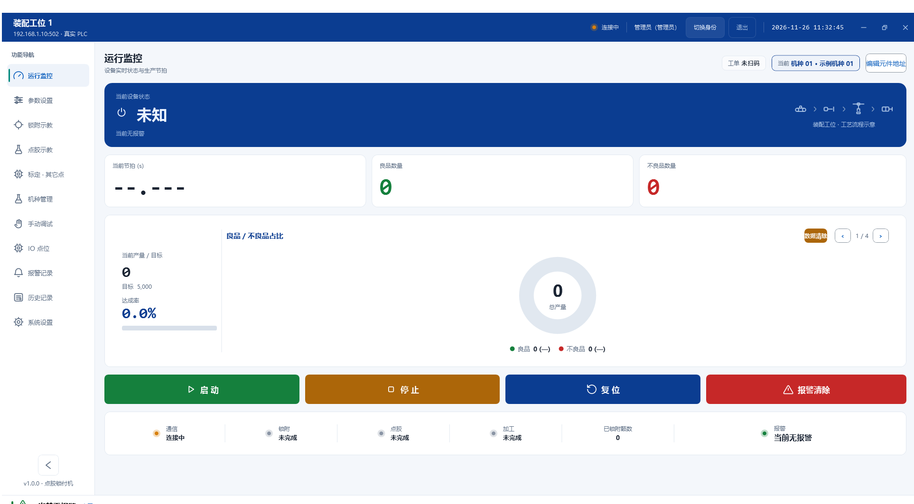
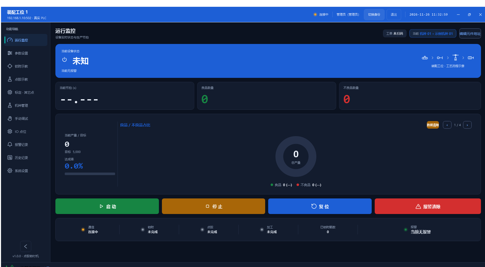
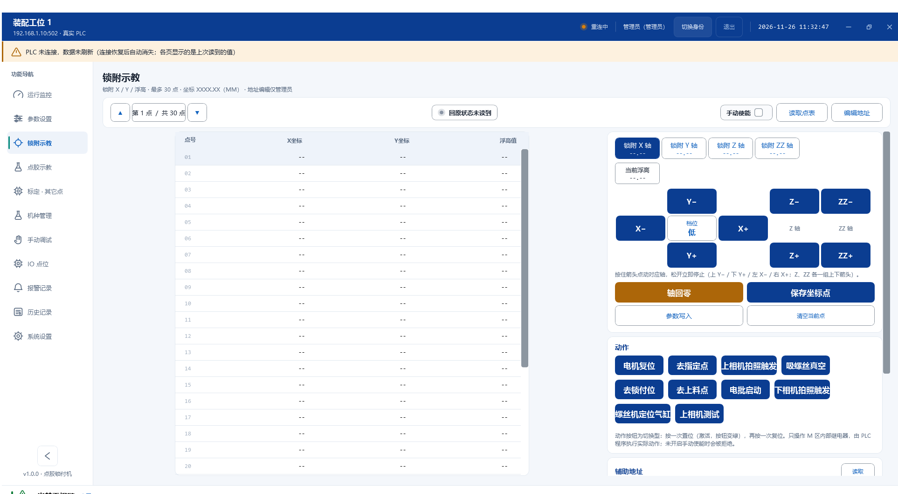
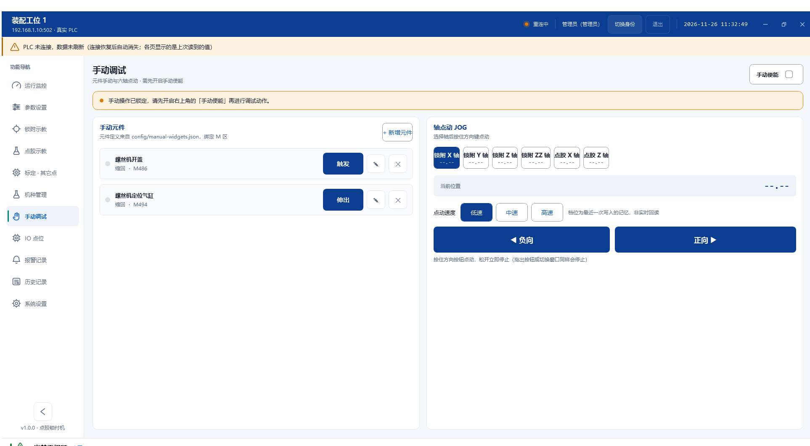
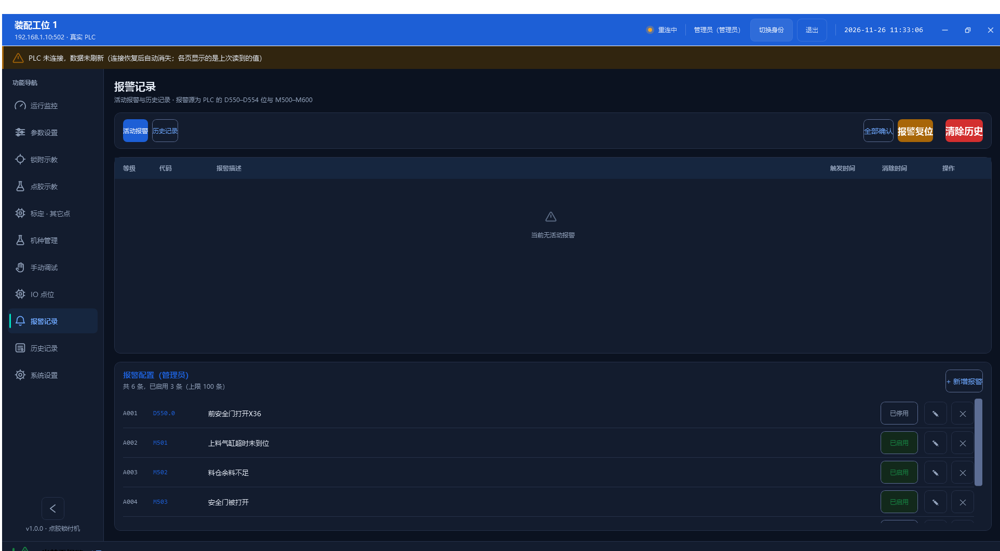

# WPF 工控上位机参考实现 · WPF HMI Reference

[English](#english) · [简体中文](#chinese)

<a id="english"></a>

## English

> Repo name `WPF-Hmi-Reference`; the code project itself stays `PlcHmi`
> (solution `PlcHmi.slnx`, assemblies `PlcHmi.*`, executable `PlcHmi.App.exe`).
>
> Replacing an HMI touch panel with an industrial PC: **process logic stays in the PLC,
> the HMI only exchanges data**. .NET 10 + WPF, Modbus TCP (OPC UA optional),
> everything configurable through JSON (points, alarms, widgets, machine recipes).

### What this is

A reference implementation of a WPF supervisory HMI, extracted from a real
dispensing/screwing machine (six axes: screw X/Y/Z/ZZ, dispense X/Z) and cleaned up
for public reading. It is a **skeleton to learn from and fork**, not a turnkey product.

Design decisions worth knowing up front:

- **Hard layering.** `Core ← Communication ← Business ← App`, one-way only, `Core` has zero
  third-party dependencies. The UI talks to abstractions; swapping Modbus TCP for OPC UA is a
  config change (`appsettings.json → plcConnection.communicationProtocol`).
- **The HMI never overrides the PLC.** It writes data and reads state — no process decisions,
  no motion commands. Cylinder and jog operations only set internal M-area relays; Y outputs
  are interlocked by the PLC program.
- **Everything is data.** Point tables, alarm definitions, manual-page widgets, machine
  models (a raw D-register snapshot), history columns and popups are JSON. Admins add a
  cylinder or a button at runtime — no build, no restart.
- **Offline by default.** A built-in Modbus TCP slave (virtual PLC, `127.0.0.1:5020`) lets
  the whole UI run without hardware.

### Identifiers: English code, Chinese comments

This project serves a **strongly localized team**, and it was originally written with
Chinese identifiers (`报警扫描服务`, `_活动标识`) so that code names matched the electrical
drawings, the JSON keys and the on-screen wording one-to-one.

For open source the source tree was renamed to **English identifiers**, while
**all comments, UI strings and log messages stay Chinese** — the reasoning behind the code
is written for the engineers who maintain the machine, in their own language.

The Chinese-identifier version is not thrown away:

- **`legacy/zh-CN/`** — full snapshot of the Chinese-identifier source (see
  [`legacy/zh-CN/README.md`](legacy/zh-CN/README.md));
- git tag `v1.0-zh-source` / branch `zh-source-backup` hold the same snapshot.

Both trees are **semantically identical**: the rename was a lexical, name-for-name
transformation (no logic edits), verified by 0-warning build, 612/612 tests and a
`--smoke` UI self-check.

Official release binaries are built **from the English-identifier tree only**.

### Architecture

```
PlcHmi.App            WPF views / view models / themes
PlcHmi.Business       alarms, recipes, teach, manual, users, history, config loading
PlcHmi.Communication  address resolution, register codecs, polling engine, virtual PLC
PlcHmi.Core           models, enums, abstractions (zero dependencies)
```

| Tech | Role |
|---|---|
| .NET 10 / WPF (`net10.0-windows`) | Runtime and UI |
| CommunityToolkit.Mvvm 8.4 | `[ObservableProperty]` / `[RelayCommand]` |
| FluentModbus 5.3 | Modbus TCP master |
| OPCFoundation.NetStandard.Opc.Ua 1.5 | OPC UA client (optional) |
| Serilog | Rolling file logs |
| xUnit | **612 tests**, including virtual-PLC integration |

### Feature highlights

| Module | Capability |
|---|---|
| Run monitor | start / stop / reset / alarm-ack, cycle time, good & defect counters, yield donut, 5-state machine status, 3-colour station lamps |
| Parameters | six-axis positioning speeds (Float32), delay table (DINT ms), speed gears, parameter tables; write-on-blur with read-back |
| Teach (screw / dispense) | column-wise point tables, jog, homing, coordinate teaching, instruction-code dropdown, live auxiliary addresses |
| Calibration / other points | top & bottom camera calibration (centre, offset, start), auxiliary point CRUD, CSV import/export |
| Machine models | model = register-section snapshot; new / copy / rename / download / read-back / CSV |
| Manual page | runtime-added cylinders and action buttons, six-axis jog (hold-to-move), speed gears |
| IO monitor | X discrete inputs, Y coils, M relays, address search and force |
| Alarms | 500 ms bit scan → raise / clear / acknowledge → history on disk, bottom banner with critical blink |
| History | M-bit rising-edge trigger, configurable columns (INT / DINT / REAL / ASCII), daily paging, CSV export, retention |
| Settings | connection, protocol, run mode (real / simulated at runtime), scanner, popups, users |
| Scanner | serial or TCP, manual or triggered mode with timeout protection, work-order echo |
| Permissions | operator / engineer / admin, re-validated in the service layer (not just hidden buttons) |

### Quick start

```powershell
# Windows 10/11 + .NET 10 SDK (Python 3 optional, for contrast / XAML / size gates)

dotnet build PlcHmi.slnx

# run — no PLC needed, see "simulation mode" below
src/PlcHmi.App/bin/Debug/net10.0-windows/PlcHmi.App.exe
```

**Simulation mode**: log in as admin → *System settings → Run mode → Simulated PLC*.
The app hosts a Modbus TCP slave, so you can poke registers with Modbus Poll offline.

**Default accounts** (sample config, **change them immediately in production**):

| Account | Role | Password |
|---|---|---|
| `operator` | Operator | `123456` |
| `engineer` | Engineer | `123456` |
| `admin` | Administrator | `123456` |

**Full gate** (build + 612 tests + UI self-check + visual checks):

```powershell
powershell tools/verify.ps1
```

`--smoke` instantiates all 11 pages and 10 dialogs and verifies the navigation count —
a wrong XAML resource key fails here instead of on site.

### Repository layout

```
WPF-Hmi-Reference/
├─ PlcHmi.slnx
├─ src/                        English identifiers, Chinese comments
│  ├─ PlcHmi.Core/             models, enums, abstractions (zero dependencies)
│  ├─ PlcHmi.Communication/    address resolution, codecs, polling, virtual PLC
│  ├─ PlcHmi.Business/         alarms / recipes / teach / manual / users / history
│  ├─ PlcHmi.App/              WPF UI (views, view models, converters, themes)
│  └─ PlcHmi.Tests/            unit + integration tests (virtual PLC fakes)
├─ legacy/zh-CN/               Chinese-identifier source snapshot (archive, not built)
├─ config/                     13 runtime JSON files (hand-editable on site)
├─ docs/                       architecture, requirements, UI system, reviews (Chinese)
└─ tools/                      build gate, publish, probing scripts
```

### Release policy

Releases contain **only binaries compiled from the English-identifier tree**.
The Chinese-identifier variant is distributed **as source** (`legacy/zh-CN/`), not as a binary,
so there is exactly one supported binary line.

### Disclaimer

This is a **sanitized reference implementation**. Customer names, production data, real
plant configuration and company branding have been removed; IP addresses and recipes are
samples. **No production-safety guarantee is provided.** Verify emergency stops, safety
circuits, interlocks, permissions and regulatory requirements yourself before running this
on real equipment.

Technical documents under `docs/` are kept in Chinese: they were written for the engineers
who maintain the machine.

---

<a id="chinese"></a>

## 简体中文

> 仓库名 `WPF-Hmi-Reference`；**代码工程名沿用 `PlcHmi`**（解决方案 `PlcHmi.slnx`，程序集 `PlcHmi.*`）。
>
> 用一台工控 PC 替代设备触摸屏：**工艺逻辑留在 PLC，上位机只做数据交互**。
> .NET 10 + WPF，Modbus TCP（可切 OPC UA），点位 / 报警 / 元件 / 机种全部配置化。
>
> **源码语言**：标识符为英文（便于开源阅读），**注释与界面文案仍为中文**；
> 中文标识符版本完整保留在 [`legacy/zh-CN/`](legacy/zh-CN/README.md)。
>
> **直接下载**：[最新英文编译版](https://github.com/YinFengLLL/WPF-Hmi-Reference/releases/latest)
> —— win-x64 自包含，解压即用，目标机免装 .NET。

---

### 一、项目为什么存在

在产线调试现场，反复遇到同一个错位：**触摸屏和工控 PC 的功能定位高度重合**。两边都在做同一件事——显示状态、改参数、按按钮、看报警。

客户那边的反馈更直接：

- 屏幕尺寸小，一屏塞不下几条参数，翻页翻到怀疑人生；
- **复杂工艺配方对触控屏极不友好**：多工步、多轴坐标、结构体化的单点工艺参数，在触屏上改一个字段要按十几次，改错还没处查；
- 想做个带条件显示的界面、想加一层权限、想把历史数据导出来——触屏要么做不到，要么要买更贵的屏和授权。

于是问题很自然：**为什么不直接用 PC 上位机把触控屏替掉？**

参考现场其他设备厂商的做法，答案其实很清楚——**分层**：

| 层 | 谁负责 | 内容 |
|---|---|---|
| 控制层 | **PLC** | 工艺逻辑、运动控制、安全联锁、互锁防呆。**一行都没有搬到上位机** |
| 交互层 | **本项目** | 看得见（状态 / 报警 / 节拍 / 产量）、改得动（参数 / 示教 / 机种）、存得住（配方 / 历史） |

职责边界很硬：上位机**只写数据、只读状态**，不参与任何工艺判定；
气缸与点动只置位 M 区内部继电器，Y 输出由 PLC 侧联锁决定——**上位机永不越权**。

**代码怎么来的**：业务代码由 AI Agent 按规格实现，功能需求由项目发起人依据工控现场经验与原触控屏的操作习惯提出
（尽量让原来会用触屏的操作工不用重新学）。需求先定框架、再审查、后编码，PLC 侧逻辑保持不变。

> 换句话说：这不是"又一个 WPF 练手项目"，而是**为了把触屏从产线上换掉**而长出来的一套上位机骨架。

---

### 二、项目背景

| 项 | 内容 |
|---|---|
| 行业 | **离散制造业运动控制**——点胶 / 锁付类多轴设备（六轴：锁附 X/Y/Z/ZZ + 点胶 X/Z） |
| PLC | **汇川 H5U 系列小型 PLC**，Modbus TCP 直连（单客户端，给触屏留连接余量）；可选 OPC UA（连 PLC 内置服务端，变量名直接寻址） |
| 部署形态 | 一台工控 PC + 一个 exe，**免安装**（自包含运行时），现场直接改 JSON |
| 交互规模 | **11 个页面** + 10 个对话框，覆盖运行、参数、示教、机种、手动、IO、报警、历史、设置、权限 |
| 界面 | 深蓝工业风，**深浅双主题**可切换，触摸优先（大按钮、无悬停依赖、无阴影） |

#### 设计思路（三个关键点）

**① 运行时可增加控制元件**

手动页的气缸、按钮、点动轴**不是写死的**。管理员在界面上"新增元件"——填名称、地址、动作类型（脉冲 / 保持 / 点动），
存进 `manual-widgets.json` 后**立即生效**，不编译、不重启。换一台设备多两个气缸，现场两分钟配好。

同理，示教页的动作按钮、辅助地址字段、标定栏、弹窗内容也都能在「编辑地址」里增删改。

**② 自定义数据结构**

机种**不是**一个固定 struct，而是**一段 D 区寄存器的快照**（默认 D2500–D3999）：切换机种 = 整段下发，保存机种 = 整段读回。
PLC 侧怎么排布，上位机就怎么存，不假设字段含义。

在此之上再叠两层寻址：

- **点表**：地址 = `基址 + 点序号 × 字每点`（浮点坐标 2 字/点，指令码 1 字/点），按轴分区读，绝不跨区连读；
- **结构体数组**：单点工艺参数（提前关胶 / 移动前出胶延时 / 关胶后延时 / 抬针高度 / 点胶速度）是结构体成员，
  成员可增删、类型可改（REAL ↔ INT16），**偏移与结构体长度自动重排**，页面上实时显示"当前为第 N 点 · 地址 D…–D…"。

**③ 点位写入**

所有地址都在 JSON 里，不写死一个数字：

| 场景 | 做法 |
|---|---|
| 普通字写入 | 直接写寄存器；写前校验区间、类型、区间重叠 |
| **D 字内位**（如 `D1210.2`） | Modbus 没有"写字内位"的功能码 → **读整字 → 改位 → 写回**，全程串行锁防并发 |
| 32 位浮点 | IEEE 754 单精度、字序 **CDAB（低字在前）**，可配置 |
| 写完确认 | 关键写入回读校验；参数"先写配方 → 读回 PLC → 存成机种"，保证三处一致 |

---

### 三、架构

```
        ┌───────────────────────────────────────────────┐
        │  PlcHmi.App        WPF 视图 / 视图模型 / 主题   │
        └───────────────────────┬───────────────────────┘
                                │ 只依赖抽象
        ┌───────────────────────▼───────────────────────┐
        │  PlcHmi.Business   报警 / 配方 / 示教 / 手动   │
        │                    用户 / 历史 / 配置加载      │
        └───────────────────────┬───────────────────────┘
                                │
        ┌───────────────────────▼───────────────────────┐
        │  PlcHmi.Communication  地址解析 / 编解码 /     │
        │                        轮询引擎 / 虚拟 PLC     │
        └───────────────────────┬───────────────────────┘
                                │
        ┌───────────────────────▼───────────────────────┐
        │  PlcHmi.Core   模型 / 枚举 / 抽象接口（零依赖）│
        └───────────────────────────────────────────────┘
```

- **单向依赖**：Core ← Communication ← Business ← App，Core **零外部依赖**；
- **通信可替换**：Modbus TCP 与 OPC UA 共用同一份 `IModbusClient` 契约，业务层零感知，配置文件里切换；
- **离线可跑**：内置虚拟 PLC（Modbus TCP 从站，默认 `127.0.0.1:5020`），不接真机也能演示全部功能；
- **轮询分级**：快 100 ms / 慢 500 ms / 事件 1 s，连续地址合并成一次请求，变化检测后只推变化的点。

| 技术 | 用途 |
|---|---|
| .NET 10 / WPF（`net10.0-windows`） | 运行时与界面 |
| CommunityToolkit.Mvvm 8.4 | `[ObservableProperty]` / `[RelayCommand]` |
| FluentModbus 5.3 | Modbus TCP 主站 |
| OPCFoundation.NetStandard.Opc.Ua 1.5 | OPC UA 客户端（可选） |
| Serilog | 文件日志（滚动保留） |
| xUnit | **612 个测试**，含虚拟 PLC 集成用例 |

---

### 四、功能一览

| 模块 | 能力 |
|---|---|
| **运行监控** | 启动 / 停止 / 复位 / 报警清除、当前节拍、良品与不良品计数、良率占比、设备状态 5 态、三色工位状态灯、已锁附颗数、当前机种与工单徽标 |
| **参数设置** | 六轴定位速度（Float32）、延时表（DINT 毫秒）、速度档位、参数表；失焦即写并回读 PLC 现值 |
| **示教（锁附 / 点胶）** | 点表按列分区读写、点动、回零、坐标示教；点胶指令码下拉选单；辅助地址实时读写（改值需先开手动使能） |
| **标定 · 其它点** | 上相机 / 下相机两套标定（中心点、偏移、启动），辅助点位增删改查与 CSV 导入导出 |
| **机种管理** | 机种 = 区段快照，新建 / 复制 / 重命名 / 下发 / 读回 / 导出导入 CSV |
| **手动调试** | 气缸与动作按钮（运行时新增）、六轴点动（按住才动、松开即停）、速度档位、当前位置 |
| **IO 点位** | X 离散输入 / Y 线圈 / M 内部继电器全量监视，支持地址搜索与强制 |
| **报警记录** | 报警位扫描（500 ms）→ 产生 / 消除 / 确认 → 历史落盘，底栏横幅 + 危险级闪烁 |
| **历史记录** | M 位上升沿触发采集，列可配（INT / DINT / REAL / ASCII），按天翻页，导出 CSV，保留期自动清理 |
| **系统设置** | 连接参数、通讯模式、运行模式（真实 / 模拟 PLC 运行期切换）、扫码枪、弹窗、用户管理 |
| **扫码枪** | 串口 / TCP 两种通讯，手动型 / 触发型；触发型带超时保护（超时写 2 并下发释放指令），工单号回显 |
| **权限** | 操作员 / 工程师 / 管理员三级，服务层二次校验（不是"藏按钮"式权限） |

---

### 五、界面截图

> 截图取自本仓库的示例配置（模拟 PLC），地址、机种与点位均为示例值。

**运行监控（浅色）** — 节拍 / 产量 / 良率 / 设备状态 / 工位状态条



**运行监控（深色）**



**锁附示教** — 点表、辅助地址、点动与动作按钮



**手动调试** — 气缸元件（运行时可新增）+ 轴点动



**报警记录** — 当前报警 / 历史报警 / 报警配置（管理员）



更多页面见 [`docs/shots-theme/`](docs/shots-theme/)（深浅两套，各 11 页）。

---

### 六、现场实际效果

在一台点胶锁付类设备上，连接**真实 PLC 与扫码枪连续运行 1 个月以上**：

- 报警、节拍、产量、良率按生产节拍实时刷新，无卡顿、无丢点；
- 示教、机种切换、参数下发全程在界面完成，**不再需要进触屏菜单翻页**；
- 历史记录按天留存并导出 CSV，追溯工单不再靠手工记录；
- 某新能源行业客户反馈：**参数集中在一屏、配方可整段切换**，换型时间明显缩短。

> 说明：以上为实际使用情况的**脱敏描述**，具体产线、客户与工艺参数不在本仓库中。

---

### 七、快速开始

```powershell
# 环境：Windows 10/11 + .NET 10 SDK（可选 Python 3，用于对比度 / XAML 资源 / 规模门禁）

dotnet build PlcHmi.slnx          # 构建（门禁要求 0 警告 0 错误）

# 直接运行（不接 PLC 时见下方"模拟模式"）
src/PlcHmi.App/bin/Debug/net10.0-windows/PlcHmi.App.exe
```

**模拟模式**：管理员登录 →「系统设置 → 运行模式」切到「模拟 PLC」（运行期生效，不跨重启记忆），
程序内置 Modbus TCP 从站，可用 Modbus Poll 等工具离线读写。

**默认账号**（示例配置，**请在生产环境立即修改**）：

| 账号 | 角色 | 默认密码 |
|---|---|---|
| `operator` | 操作员 | `123456` |
| `engineer` | 工程师 | `123456` |
| `admin` | 管理员 | `123456` |

**完整门禁**（构建 + 612 测试 + 界面自检 + 视觉检查）：

```powershell
powershell tools/verify.ps1
```

**发布**（win-x64 自包含，现场免装 .NET）：

```powershell
powershell tools/publish.ps1       # 产物在 publish/，整目录拷贝即可部署
```

> `--smoke` 会实例化全部 11 个页面与 10 个对话框并校验导航项数——XAML 资源键写错在这里就现形。

---

### 八、目录结构

```
WPF-Hmi-Reference/
├─ PlcHmi.slnx
├─ src/                       英文标识符 + 中文注释
│  ├─ PlcHmi.Core/            模型、枚举、抽象接口（零依赖）
│  ├─ PlcHmi.Communication/   地址解析、寄存器编解码、轮询引擎、虚拟 PLC
│  ├─ PlcHmi.Business/        报警 / 配方 / 示教 / 手动 / 用户 / 历史 / 配置加载
│  ├─ PlcHmi.App/             WPF 界面（视图 / 视图模型 / 转换器 / 主题资源）
│  └─ PlcHmi.Tests/           单元 + 集成测试（含虚拟 PLC 替身）
├─ legacy/zh-CN/              中文标识符版源码（存档，不参与构建）
├─ config/                    13 个 JSON 运行配置（现场可手改）
├─ docs/                      架构、需求、UI 设计、审查与门禁文档（中文）
└─ tools/                     构建门禁、发布、探测脚本
```

---

### 九、发布策略

发布包**只用英文标识符的主线源码编译**。中文标识符版以**源码形式**提供
（[`legacy/zh-CN/`](legacy/zh-CN/README.md) + 标签 `v1.0-zh-source`），不发独立安装包，
保证只有一条受支持的二进制线。

---

### 十、脱敏说明与免责声明

**这是脱敏后的参考实现。** 为便于公开阅读，本仓库已做如下处理：

- 已移除**客户信息**（客户名称、产线、工单数据均不包含在本仓库中）；
- 已移除**现场配置**：IP 地址、端口、网口参数均替换为示例值（`192.168.1.10` / `192.168.1.11` / `127.0.0.1`）；
- 已移除**真实工艺数据**：机种配方为空快照，机种名、点位、坐标均为示例；
- 已移除公司标识、Logo、图片资源与个人署名。

> ⚠️ **不提供任何生产安全保证。**
> 工业现场使用需**自行评估并落实**安全、联锁、权限与合规要求。
> 这是参考实现，不是可直接投产的成品：正式上线前必须完成真机联调、急停与安全回路验证、
> 权限分级评审、断网 / 断电 / 通讯超时的降级验证，并按所在行业法规与客户规范做完整验收。
> 由使用者自行承担因直接或间接使用本项目产生的全部风险。

---

### 十一、文档

| 文档 | 内容 |
|---|---|
| [docs/01 架构与现状](docs/01-项目架构与实施现状.md) | 分层、模块职责、软元件映射、轮询与通讯 |
| [docs/02 需求设计](docs/02-参数-示教-机种需求设计.md) | 参数页 / 示教页 / 机种页的需求与地址规划 |
| [docs/06 UI 设计系统](docs/06-UI设计系统与界面优化方案.md) | 色板、间距、组件库、对比度要求 |
| [docs/08 标识符中文化](docs/08-标识符中文化改造与坑点.md) | 中文命名的边界与规范（历史记录：开源版已改为英文标识符） |
| [docs/12 机种数据模型](docs/12-机种数据模型（D2500-D3500快照）.md) | 区段快照的存储与切换语义 |
| [docs/14 发布包结构](docs/14-发布包结构与现场升级策略.md) | 免安装部署、覆盖升级不丢现场数据 |
| [docs/04 审查标准](docs/04-代码审查标准与流程.md) · [docs/05 门禁](docs/05-静态分析器与门禁.md) | 工程纪律与自动化门禁 |

> 注：`docs/` 为开发期技术文档存档（中文），文中出现的修订编号仅指文档自身的迭代，与发布版本号无关；
> 文档里的中文标识符示例对应 [`legacy/zh-CN/`](legacy/zh-CN/README.md) 的存档代码。
